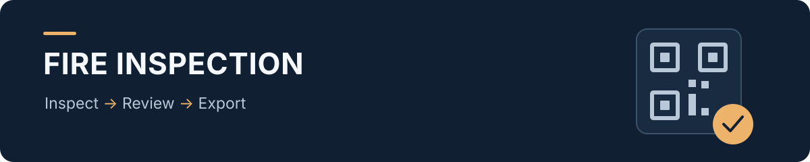
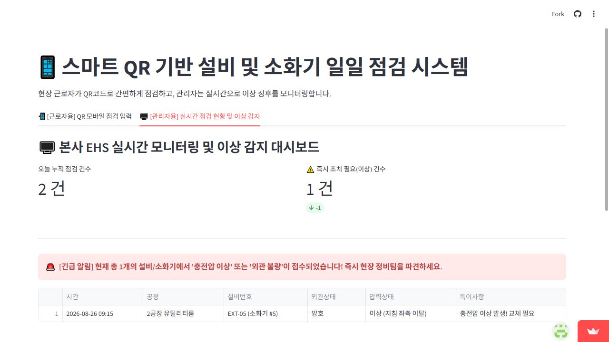

# 스마트 QR 소화기 점검 프로토타입

**소화기 점검 결과를 입력하고, 이상 항목을 모아 확인하는 흐름을 구현한 개인 프로젝트입니다.**

[웹앱 열기](https://smart-qr-system-runmm.streamlit.app/) · [주요 코드](app.py)

`Python` `Streamlit` `pandas` `openpyxl`

## 실제 화면



가상의 점검 기록 2건 중 압력 이상 1건을 분리해 보여주는 화면입니다. 점검자·관리자 탭은 동일 브라우저 세션에서 사용 흐름을 체험하도록 구성했습니다.

## 기획 배경

현장 점검을 기록한 뒤 관리자가 다시 취합하는 과정에서는 입력 내용과 조치가 필요한 항목을 함께 살펴야 합니다. 이 과정을 하나의 화면 흐름으로 연결해 보고자, 소화기를 대상으로 **점검 입력 → 이상 항목 구분 → 전체 이력 확인 → Excel 내보내기**를 구현했습니다.

설비에 부착된 QR코드로 점검 화면에 접근하는 사용 장면을 기획했습니다. 현재 버전에서는 공정과 관리번호를 직접 입력하며, QR 접근 이후의 점검 흐름을 시연합니다.

## 처음 보는 분을 위한 사용 순서

1. **근로자용 탭**에서 점검 공정과 소화기 관리번호를 입력합니다.
2. 소화기 본체·호스의 **외관 상태**, **압력게이지 상태**, 특이사항을 기록하고 제출합니다.
3. **관리자용 탭**으로 이동해 점검 건수와 이상 건수를 확인합니다.
4. 외관 불량 또는 압력 이상으로 분류된 기록을 먼저 확인하고, 전체 로그를 Excel 파일로 내려받습니다.

시작 시 가상의 점검 기록 2건이 표시됩니다. 압력을 `이상`으로 선택해 한 건을 추가하면, 관리자 탭의 이상 항목 목록이 어떻게 바뀌는지 확인할 수 있습니다.

## 구현 기능

| 구분 | 현재 구현 |
| --- | --- |
| 점검 입력 | 공정 4개 선택지, 관리번호, 외관·호스 상태, 압력 상태, 특이사항 입력 |
| 입력 결과 안내 | 압력 이상 여부에 따라 화면에 경고 또는 완료 메시지 표시 |
| 점검 현황 | 현재 세션에 저장된 전체 점검 건수와 이상 건수 요약 |
| 이상 항목 확인 | 외관 불량 또는 압력 이상 기록을 별도 표로 표시 |
| 이력 확인 | 시간·공정·설비번호·점검 결과·특이사항을 표로 조회 |
| 파일 내보내기 | 현재 세션의 전체 기록을 `Smart_Inspection_Logs.xlsx`로 다운로드 |

두 탭은 **한 브라우저 세션 안에서 입력자와 관리자의 사용 흐름을 살펴보는 시연 화면**입니다.

## 실행 방법

개발 환경 설정은 Python 3.11을 기준으로 작성되어 있습니다.

```bash
git clone https://github.com/Safety-Bin/smart-QR-system.git
cd smart-QR-system
python -m venv .venv
```

Windows에서는 가상환경을 활성화한 뒤 다음과 같이 실행합니다.

```powershell
.\.venv\Scripts\Activate.ps1
python -m pip install -r requirements.txt
python -m streamlit run app.py
```

macOS·Linux에서는 `source .venv/bin/activate`로 활성화한 뒤 같은 설치·실행 명령을 사용하면 됩니다.

## 핵심 파일 구성

```text
smart-QR-system/
├── app.py                         # 점검 입력·현황 확인·Excel 내보내기
├── requirements.txt               # 실행에 필요한 Python 패키지
└── .devcontainer/
    └── devcontainer.json          # 개발 환경과 미리보기 설정
```

## 데이터 저장과 현재 범위

- 점검 기록은 `st.session_state`에 저장합니다. 영구 데이터베이스가 없으므로 세션이 종료되거나 초기화되면 기록이 유지되지 않을 수 있습니다. 필요한 기록은 Excel로 내보낼 수 있습니다.
- 다른 사용자의 브라우저와 기록을 공유하거나, 관리자에게 별도의 알림을 전송하는 기능은 아직 구현하지 않았습니다. 경고는 현재 화면에 표시합니다.
- QR코드 생성·스캔·설비정보 자동 입력, 로그인과 권한 구분은 향후 개선 항목입니다.
- 화면의 ‘오늘 누적 점검 건수’는 현재 날짜로 필터링하지 않은 **세션 전체 건수**이며, 시작 예제 2건도 포함합니다.
- 소화기의 외관과 압력을 중심으로 만든 시연용 점검 항목입니다. 사업장 운영에 적용하려면 설비별 점검 기준과 기록 보존, 조치 결과 관리 등을 추가로 검토해야 합니다.

## 기획과 제작에서 맡은 역할

소방·안전 업무에 대한 관심을 바탕으로, 현장에서 입력할 점검 항목과 관리자가 먼저 확인할 정보를 정리했습니다. 점검자·관리자 화면의 흐름을 기획하고, **생성형 AI와 협업해 Python·Streamlit 코드 및 프로토타입을 구현**했습니다.

이 프로젝트에서는 안전 실무의 요구를 입력 항목과 화면 흐름으로 구체화하는 과정을 경험했습니다. 개인 포트폴리오로 제작했으며, 회사에 도입하거나 운영 성과를 측정한 프로젝트는 아닙니다.

## 다음 개선 방향

- 설비별 QR 링크와 관리번호 자동 입력
- 영구 저장소 및 사용자별 접근 권한
- 점검 대상 대비 미점검 설비 확인
- 담당자·조치 기한·완료 여부를 포함한 후속 조치 관리
- 날짜별 조회와 중복 입력·빈 관리번호 검증

